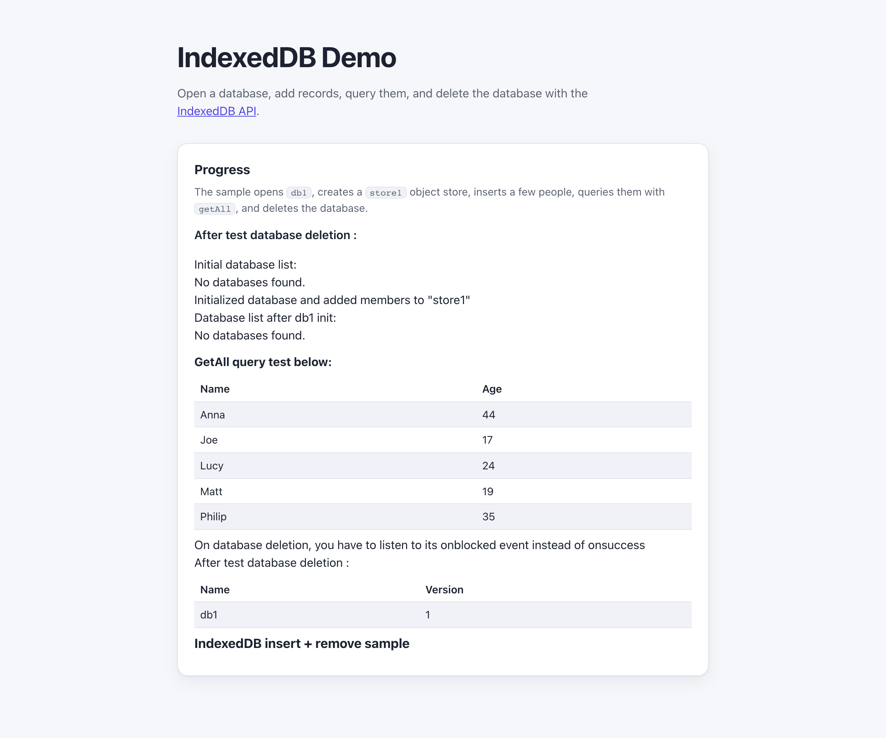

# WebSharper.IndexedDB

[](https://github.com/dotnet-websharper/w3c-indexeddb)

WebSharper bindings for the [IndexedDB API](https://developer.mozilla.org/en-US/docs/Web/API/IndexedDB_API) —
opening databases, storing records, querying them, and deleting the database from F# and C# web apps.

IndexedDB is a transactional, object-oriented database built into the browser. The binding exposes the
`IDBFactory`, `IDBDatabase`, `IDBTransaction`, `IDBObjectStore`, `IDBIndex`, and `IDBKeyRange` types.

This repository contains:

| Project | Purpose |
| --- | --- |
| `WebSharper.IndexedDB` | The binding: WIG definitions for `IDBFactory`, `IDBDatabase`, `IDBTransaction`, `IDBObjectStore`, `IDBIndex`, `IDBKeyRange`, `IDBCursor`, `IDBRequest`, `IDBOpenDBRequest`, and the option types. |
| `WebSharper.IndexedDB.Extensions` | The `[<Inline>]` client extensions exposing `window.indexedDB` and promise helpers on `IDBObjectStore`. |
| `WebSharper.IndexedDB.Sample` | A Bundle sample that opens a database, inserts records, queries them, and deletes the database. |

## Live demos

**Try it live:** [Open the sample in your browser](https://dotnet-websharper.github.io/w3c-indexeddb/)



The sample doubles as the binding's [test case](#running-the-sample): it opens `db1`, creates a `store1` object store, inserts a few people, queries them with `getAll`, and deletes the database.

- **Sample (this repository):** <https://dotnet-websharper.github.io/w3c-indexeddb/>
- **Source repository:** <https://github.com/dotnet-websharper/w3c-indexeddb>
- **WebSharper bindings:** <https://websharper.com/bindings>

## Features

- `IDBFactory` (`open`, `deleteDatabase`, `cmp`, `databases`).
- `IDBDatabase` (`name`, `version`, `objectStoreNames`, `createObjectStore`, `deleteObjectStore`, `transaction`).
- `IDBTransaction` (`db`, `durability`, `mode`, `objectStore`, `onabort`, `oncomplete`, `onerror`).
- `IDBObjectStore` (`add`, `put`, `get`, `getKey`, `getAll`, `getAllKeys`, `delete`, `clear`, `count`, `createIndex`, `deleteIndex`, `index`, `openCursor`, `openKeyCursor`).
- `IDBIndex` (`get`, `getKey`, `getAll`, `getAllKeys`, `count`, `openCursor`, `openKeyCursor`).
- `IDBCursor` / `IDBCursorWithValue` (`advance`, `continue`, `continuePrimaryKey`, `delete`, `update`).
- `IDBKeyRange` (`bound`, `only`, `lower`, `upper`, `includes`).
- `IDBRequest` / `IDBOpenDBRequest` (`result`, `error`, `source`, `readyState`, `transaction`, `onsuccess`, `onerror`, `onblocked`, `onupgradeneeded`).
- `IDBVersionChangeEvent` and the option types (`IDBObjectStore.CreateOptions`, `IDBObjectStore.IndexOptions`, `IDBTransaction.Options`, `IDBTransaction.TransactionDurability`).
- Extensions: `window.indexedDB` and `IDBObjectStore.AddPromise`.

## Installation

The binding is not currently published to NuGet. Reference the projects from source:

```bash
git clone https://github.com/dotnet-websharper/w3c-indexeddb.git
```

```xml
<ItemGroup>
  <ProjectReference Include="path/to/WebSharper.IndexedDB/WebSharper.IndexedDB.fsproj" />
  <ProjectReference Include="path/to/WebSharper.IndexedDB.Extensions/WebSharper.IndexedDB.Extensions.fsproj" />
</ItemGroup>
```

## Usage

```fsharp
namespace WebSharper.IndexedDB.Demo

open WebSharper
open WebSharper.IndexedDB
open WebSharper.JavaScript

type Person = { Name: string; Age: uint }

[<JavaScript>]
module Demo =
    let openDatabase () =
        let request = JS.Window.IndexedDB.Open("db1", As<uint32> 1)

        request.Onupgradeneeded <- (fun _ ->
            let db = request.Result
            db.CreateObjectStore(
                "store1",
                IDBObjectStore.CreateOptions(KeyPath = "Name", AutoIncrement = false)
            )
            |> ignore
        )

        request.Onsuccess <- (fun _ ->
            let db = request.Result
            let tx = db.Transaction([|"store1"|], IDBTransaction.TransactionMode.Readwrite)
            tx.ObjectStore("store1").Add({ Name = "Ada"; Age = 36u }) |> ignore
        )
```

`window.indexedDB` is exposed by the Extensions assembly. IndexedDB requests are asynchronous: use the
`onsuccess` / `onerror` handlers on `IDBRequest`, and listen for `oncomplete` on the transaction.

## Running the sample

Build the sample in Release and serve its static output:

```bash
dotnet build WebSharper.IndexedDB.Sample/WebSharper.IndexedDB.Sample.fsproj -c Release
python3 -m http.server -d WebSharper.IndexedDB.Sample 8102
```

Open <http://localhost:8102/>. The page runs the sample automatically, shows the progress log and the
`getAll` query result, and lets you run it again.

## Building from source

### Prerequisites

- [.NET SDK 10](https://dotnet.microsoft.com/download) or later.

### Build

```bash
dotnet build WebSharper.IndexedDB.sln -c Release
```

The binding and Extensions projects target `netstandard2.0`; the sample targets `net10.0`.

## Deployment

Pushing to `main` triggers `.github/workflows/ghpages.yml`, which builds the sample in Release and publishes
`index.html`, `site.css`, and the generated `Content/` directory to the `gh-pages` branch.

## Repository layout

```
WebSharper.IndexedDB/              # binding (WIG definitions)
  Main.fs
WebSharper.IndexedDB.Extensions/   # [<Inline>] client extensions
  Library.fs
WebSharper.IndexedDB.Sample/       # Bundle sample
  Client.fs
  index.html
  site.css
  Content/                          # generated at build time (gitignored)
docs/sample.png
.github/workflows/ghpages.yml       # build + deploy the sample to GitHub Pages
```

## Notes on the API

- **Asynchronous requests:** IndexedDB is asynchronous. Each `open`, `get`, `getAll`, `add`, and `put` returns an
  `IDBRequest`; use `onsuccess` and `onerror` to read the result or the error.
- **Transactions:** `IDBDatabase.transaction` takes the store-name array and a mode. A transaction completes
  when all its requests succeed; use `oncomplete` to run cleanup.
- **Version upgrades:** `createObjectStore` and `deleteObjectStore` can only be called from the
  `onupgradeneeded` handler.
- **Generic queries:** `getAll<'T>`, `get<'T>`, `getKey<'T>`, and `openCursor<'T>` are generic; the result is
  typed as `IDBRequest<'T>` or `IDBRequest<IDBCursorWithValue<'T>>`.
- **Deletion can block:** `deleteDatabase` may block while a connection is open. Listen for `onblocked` on the
  `IDBOpenDBRequest`.
- **Extensions:** `window.indexedDB` and the `IDBObjectStore.AddPromise` helpers live in the Extensions assembly,
  so reference both projects.
- **Browser storage:** IndexedDB is available in all modern browsers. Private browsing may limit or disable
  storage.

## License

Apache 2.0 — see [LICENSE.md](LICENSE.md).
